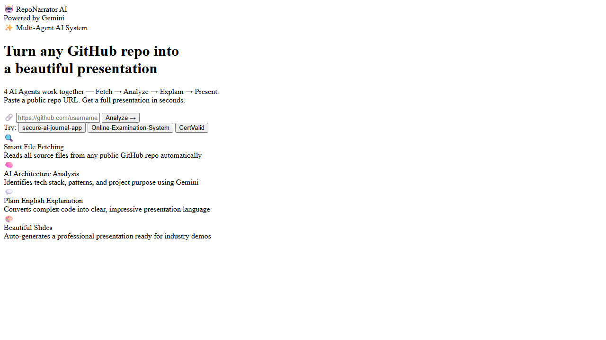
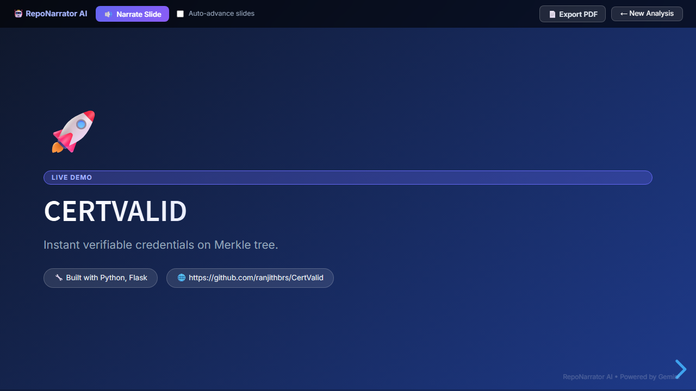
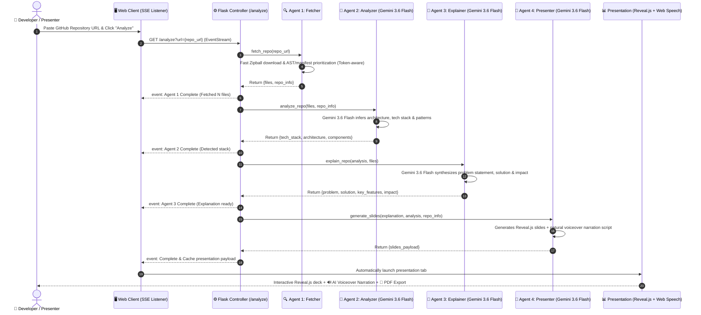

# 🤖 RepoNarrator AI — Multi-Agent GitHub Presentation Generator

[](https://www.python.org/downloads/)
[](https://ai.google.dev/)
[](agents/)
[-success?style=for-the-badge)](app.py)
[](test_pipeline.py)
[](https://medium.com/@ranjithb2k06/building-an-autonomous-4-agent-pipeline-with-google-gemini-2-0-flash-and-server-sent-events-65d0bc944d2c)
[](LICENSE)

> 🌟 **Transform any code project into an interactive, narrated presentation deck in seconds — featuring real-time architecture synthesis, browser Web Speech voiceover, and one-click PDF export!**

---

## 📸 Screenshots & Visual Walkthrough

| 🖥️ Multi-Agent Analysis Dashboard | 📊 Live Interactive Presentation Deck |
| :---: | :---: |
|  |  |
| *Real-time SSE event pipeline streaming 4 agent phases* | *Reveal.js deck with AI voiceover narration & PDF export* |

---

## 💡 What is RepoNarrator AI in 30 Seconds? (In Plain English)

Imagine you built or found an amazing software project on GitHub, but you need to explain it to a teacher, a client, a hiring manager, or an investor who **does not code**. 

Normally, you would spend hours reading files, taking screenshots, and making PowerPoint slides.

**RepoNarrator AI does all of that for you in under 15 seconds!**  
You simply paste any GitHub link, and **4 autonomous AI helpers work together like a creative team**:
1. 🔍 **Agent 1 (The Reader):** Reads the project code files from GitHub.
2. 🧠 **Agent 2 (The Architect):** Understands what tools, databases, and languages were used.
3. 💬 **Agent 3 (The Storyteller):** Explains what problem the project solves in clear, simple business language.
4. 🎨 **Agent 4 (The Designer):** Automatically generates a clean, interactive slide presentation that you can present right inside your browser!

---

## ❓ The Problem & Solution

| ❌ The Hard Way (Manual Work) | ✅ The Smart Way (RepoNarrator AI) |
| :--- | :--- |
| Spending 3 to 4 hours manually designing presentation slides. | Generates animated, executive-ready slides in 15 seconds. |
| Hard for non-programmers to understand complex code. | Translates raw code into simple real-world benefits. |
| Static PowerPoint files that quickly become outdated. | Interactive browser slides with live animations and code highlights. |

---

## 📑 Table of Contents
- [What is RepoNarrator AI?](#-what-is-reponarrator-ai-in-30-seconds-in-plain-english)
- [The Problem & Solution](#-the-problem--solution)
- [Multi-Agent Architecture & Sequence](#-multi-agent-architecture--sequence)
- [Agent Decomposition](#-agent-decomposition)
- [Key Technical Highlights](#-key-technical-highlights)
- [Interactive Demonstration Workflow](#-interactive-demonstration-workflow)
- [Repository Structure](#-repository-structure)
- [Local Development Setup](#-local-development-setup)
- [Author & Connect](#-author)
- [License](#-license)

---

## 📐 Multi-Agent Architecture & Sequence

The application choreographs four specialized AI agents connected via real-time **Server-Sent Events (SSE)**. State and artifacts pass downstream sequentially while streaming live progress directly to the browser UI:



---

## 🤖 Agent Decomposition

| Agent | Core Responsibility | Inputs | Outputs | AI Engine / Tool |
| :--- | :--- | :--- | :--- | :--- |
| **Agent 1: Fetcher** | Fetches code via high-speed GitHub zipball stream (bypassing 60 req/hr limits) with token-aware REST API fallback, AST/manifest prioritization, and binary stripping. | GitHub Repository URL | Manifest of key code files & repo metadata | Zipball stream + GitHub REST API v3 |
| **Agent 2: Analyzer** | Inspects project directory hierarchies, package manifests, and code files to identify architecture patterns (MVC, Microservices, Event-Driven) and dependencies. | Filtered code files & metadata | Technical profile (languages, frameworks, DBs, design patterns) | Google Gemini 3.6 Flash |
| **Agent 3: Explainer** | Distills complex technical implementations into executive value propositions, problem definitions, architectural advantages, and real-world impact. | Technical profile & key files | Structured business & technical narrative | Google Gemini 3.6 Flash |
| **Agent 4: Presenter** | Transforms narrative points into structured Reveal.js presentation slides and slide-by-slide voice narration scripts. | Technical narrative & profile | Validated Reveal.js slide deck schema + voice scripts | Google Gemini 3.6 Flash + Web Speech API |

---

## ✨ Key Technical Highlights

1. **Autonomous Agentic Pipeline**:
   - Sequential multi-agent workflow where each agent operates with focused system instructions and specialized output schemas.
   - Graceful fallback routines for large codebases (context truncation, priority heuristics).

2. **Real-time Observability via Server-Sent Events (SSE)**:
   - Utilizes `text/event-stream` to establish a persistent unidirectional pipeline from the Python server to the frontend.
   - Eliminates polling latency while providing step-by-step transparency into agent thought processes and status.

3. **Reveal.js Presentation Engine**:
   - Generates interactive, accessible HTML5 slides with smooth 2D transition animations.
   - Full keyboard navigation support (<kbd>→</kbd>, <kbd>←</kbd>, <kbd>Space</kbd>, <kbd>Esc</kbd> for slide overview).
   - Embedded speaker notes and responsive layout for widescreen monitors and projectors.

4. **Zero-Hardcoding Configuration**:
   - Environment-driven API key management supporting both local `.env` and production PaaS environments.

---

## 🎯 Interactive Demonstration Workflow

1. **Launch**: Start the application and visit `http://127.0.0.1:5000`.
2. **Select Target Repository**: Click one of the quick chips or input any public GitHub URL (e.g. `https://github.com/ranjithbrs/secure-ai-journal-app`).
3. **Trigger Pipeline**: Click **Analyze →**.
4. **Live Agent Activity**: Observe the 4-agent status cards illuminate in real time:
   - 🔍 *Fetcher: Fetching repository tree and manifests...*
   - 🧠 *Analyzer: Identifying tech stack and architectural design...*
   - 💬 *Explainer: Distilling engineering impact and problem statement...*
   - 🎨 *Presenter: Compiling Reveal.js slide deck...*
5. **Interactive Deck**: A presentation window immediately launches, ready for live stakeholder presentations or technical interviews.

---

## 📁 Repository Structure

```text
reponarrator-ai/
├── app.py                      # Flask backend, SSE event streaming route & view controllers
├── Procfile                    # Production Gunicorn process manager definition
├── requirements.txt            # Python dependencies (Flask, google-genai, requests)
├── test_pipeline.py            # Unified unittest suite (17 offline unit tests + live integration)
├── .env.example                # Template for Gemini API key & optional GitHub token
├── README.md                   # Comprehensive project documentation
├── assets/                     # Genuine UI screenshots and sample PDF export
│   ├── dashboard_preview.png   # Main analysis dashboard screenshot
│   ├── presentation_preview.png# Generated Reveal.js slide screenshot
│   └── presentation_exported.pdf# Sample exported presentation deck
├── agents/
│   ├── fetcher.py              # Agent 1: GitHub API & zipball stream extraction
│   ├── analyzer.py             # Agent 2: Architecture & tech stack inference
│   ├── explainer.py            # Agent 3: Narrative & technical synthesis
│   └── presenter.py            # Agent 4: Reveal.js slides & voiceover generation
├── static/
│   ├── style.css               # Dark glassmorphic design system
│   └── script.js               # SSE client listener & dynamic UI renderer
└── templates/
    ├── index.html              # Main multi-agent analysis dashboard
    └── presentation.html       # Full-screen Reveal.js presentation canvas
```

---

## 🚀 Local Development Setup

### Prerequisites
- Python 3.10 or higher installed.
- A **Google Gemini API Key** (obtain free from [Google AI Studio](https://aistudio.google.com/)).

### 1. Clone the Repository
```bash
git clone https://github.com/ranjithbrs/reponarrator-ai.git
cd reponarrator-ai
```

### 2. Install Dependencies
```bash
pip install -r requirements.txt
```

### 3. Configure Environment Variables
Create a `.env` file in the root folder (or copy from `.env.example`):
```env
# Required: Google Gemini API Key
GEMINI_API_KEY=your_gemini_api_key_here

# Optional: GitHub Personal Access Token (boosts rate limit to 5000 req/hr)
# GITHUB_TOKEN=your_github_token_here
```

### 4. Run the Application
```bash
python app.py
```
Open your browser at `http://127.0.0.1:5000`.

### 5. Automated Multi-Repo Verification Suite
Run the built-in test suite to verify all 4 agents against diverse repo stacks:
```bash
python test_pipeline.py
```

---

## ☁️ Deployment Guide

### Deploying to Render
1. Push your repository to GitHub.
2. In [Render Dashboard](https://dashboard.render.com/), create a new **Web Service**.
3. Select your repository `ranjithbrs/reponarrator-ai`.
4. Configure service parameters:
   - **Environment**: `Python`
   - **Build Command**: `pip install -r requirements.txt`
   - **Start Command**: `gunicorn app:app --workers 1 --threads 8 --timeout 120`
5. In **Environment Variables**, add:
   - `GEMINI_API_KEY` = your Gemini API key
6. Click **Deploy**. Your app will be live at `https://<your-service>.onrender.com`!

### Deploying to PythonAnywhere
1. Open a Bash console and clone the repo:
   ```bash
   git clone https://github.com/ranjithbrs/reponarrator-ai.git
   ```
2. Create and activate a virtualenv with Python 3.10+:
   ```bash
   mkvirtualenv --python=/usr/bin/python3.10 reponarrator-venv
   pip install -r requirements.txt
   ```
3. Set your `GEMINI_API_KEY` in your `.env` or in the WSGI configuration file.
4. Set the WSGI application to point to `app:app` and reload your Web App!

---

## 👨‍💻 Author

**Ranjith B**  
🎓 *B.Tech Computer Science & Business Systems (CSBS)*  
🏛️ *Nehru Institute of Engineering and Technology, Coimbatore*  

- 💼 **LinkedIn**: [linkedin.com/in/ranjith-b-csbs](https://linkedin.com/in/ranjith-b-csbs)  
- 🐙 **GitHub**: [github.com/ranjithbrs](https://github.com/ranjithbrs)  
- 🌐 **Portfolio**: [ranjithbrs.github.io/portfolio](https://ranjithbrs.github.io/portfolio/)  
- 📧 **Email**: ranjithb2k06@gmail.com  

---

## 📄 License

This project is licensed under the [MIT License](LICENSE).
